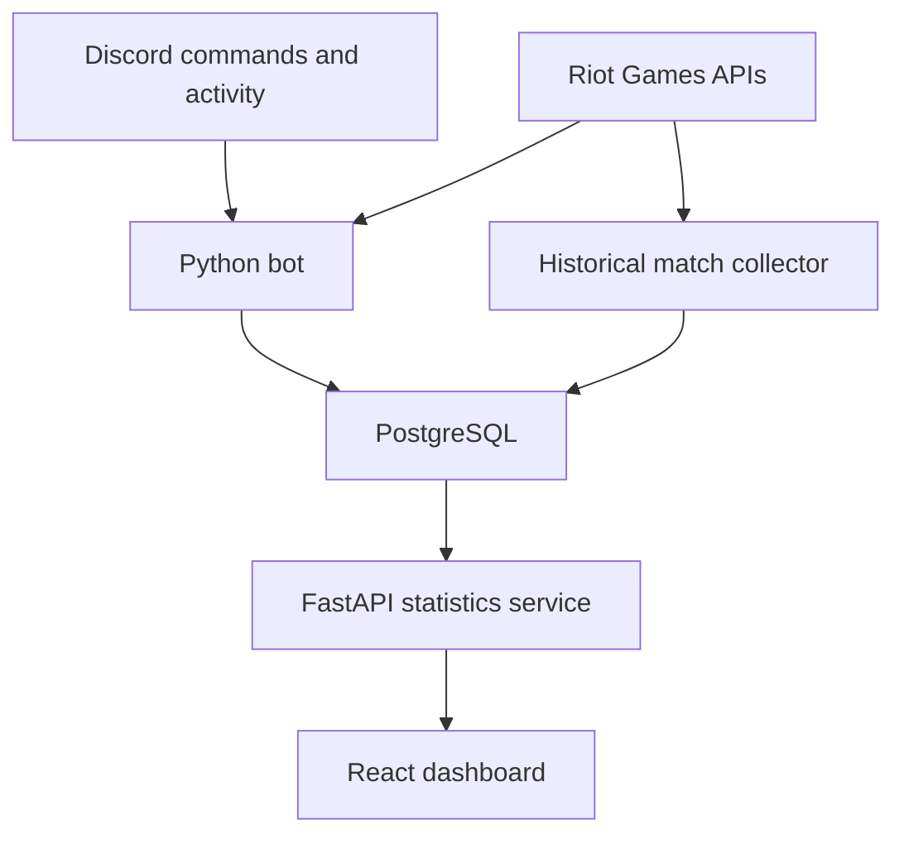

# LeagueMatch

A Python Discord bot and web dashboard for live League of Legends match information and historical ranked matchup statistics.

LeagueMatch connects Riot Games APIs, PostgreSQL, a FastAPI statistics service, and a React dashboard. The bot supports linked accounts across multiple Discord servers, automated match announcements, player rank caching, and historical rune and summoner-spell setup scores.

## Project Status

The bot is in active development and uses a Riot development key for private testing. The dashboard and statistics API have hosting configurations for Vercel and Render, with Neon PostgreSQL as the shared database.

Historical match collection runs as a separate script. Setup scoring is implemented, but its usefulness has not been independently validated. Scores describe historical observations; they are not predictions of a live match’s outcome.

## Features

- Link Riot accounts to Discord users independently in each server.
- Request live match information through slash commands.
- Check visible Discord activity every 60 seconds for automated announcements.
- Track previously announced match IDs to prevent repeated notifications.
- Persist player ranks in PostgreSQL for reuse.
- Collect ranked solo match observations, including matchups, roles, runes, spells, outcomes, and rank snapshots.
- Display aggregate win rates and sample sizes with champion, role, and patch filters.
- Provide paginated statistics through a read-only FastAPI service.
- Calculate historical setup scores with rank weighting, smoothing, and minimum sample requirements.
- Save player summaries and reuse them in subsequent match alerts.

## Technology Stack

| Component | Technologies |
|---|---|
| Discord bot | Python, discord.py, aiohttp |
| Database access | PostgreSQL, asyncpg |
| Statistics API | FastAPI |
| Frontend | React, TypeScript, Vite |
| Hosting | Neon, Render, Vercel |
| Data sources | Riot Games APIs, Data Dragon |
| API testing | FastAPI TestClient, pytest |

## Architecture



The bot manages account links, server settings, live announcements, and cached ranks. The collector writes historical match observations. FastAPI reads aggregate statistics, and the dashboard displays the results without calling Riot directly. The bot saves player summaries so subsequent match alerts can include previously stored information.

## Discord Commands

| Command | Purpose |
|---|---|
| `/link` | Link a Riot account using its game name and tag line |
| `/live` | Retrieve the linked player’s current match |
| `/tracking` | Enable or disable automated announcements |
| `/unlink` | Remove the account link in the current server |
| `/setchannel` | Set the announcement channel; requires Manage Server |
| `/activity` | Inspect activity visible to the bot |

Linking does not require a Riot password.

## Database Design

| Table | Purpose |
|---|---|
| `linked_accounts` | Account links, platform, tracking preference, and last announced match |
| `guild_settings` | Announcement channel for each Discord server |
| `match_stats` | Historical participant and matchup observations |
| `player_rank_cache` | Saved ranks keyed by player and platform |

The implementation uses parameterized queries, composite primary keys, unique constraints, and PostgreSQL upserts.

Statistics queries use connection pooling and read-only repeatable-read transactions to keep summaries and paginated results consistent while the collector inserts data.

## Historical Setup Scores

Setup scores summarize observed results for a champion’s keystone and summoner-spell combination.

The implementation:

- Requires at least 20 observations for the selected setup.
- Weights observations by rank tier.
- Uses Emerald observations when higher-tier samples are insufficient.
- Smooths results toward the champion’s observed baseline.
- Returns no score when sample requirements are unmet.

These scores aggregate across roles and do not estimate the probability of winning a specific live matchup. Rank snapshots reflect rank at collection time.

## Run the Bot

```bash
git clone https://github.com/ReymondOH/LeagueMatch-Discord-Bot.git
cd LeagueMatch-Discord-Bot
python -m venv .venv
```

Activate the environment:

```powershell
# Windows PowerShell
.\.venv\Scripts\Activate.ps1
```

```bash
# macOS / Linux
source .venv/bin/activate
```

Install dependencies:

```bash
python -m pip install -r requirements.txt
```

Create a local `.env` file:

```dotenv
DISCORD_TOKEN=your_discord_bot_token
RIOT_API_KEY=your_riot_api_key
DB_HOST=your_postgresql_hostname
DB_PORT=5432
DB_NAME=your_database_name
DB_USER=your_database_user
DB_PASSWORD=your_database_password
DB_SSL=require
```

The PostgreSQL database and user must already exist. Verify SSL configuration in the database connection functions for your provider.

Enable the **Presence** and **Server Members** intents in the Discord Developer Portal. Install the bot with the `bot` and `applications.commands` scopes and permissions to view the announcement channel, send messages, and embed links.

```bash
python bot.py
```

## Collect Historical Matches

Run the collector separately:

```bash
python -m services.stats_collector
```

The current entry point samples up to six stored players and requests up to ten recent match IDs per player. It retains ranked solo games with ten participants and pairs opposing participants by recorded role.

The collector must write to the database used by FastAPI to update dashboard statistics. It is not currently scheduled automatically.

## Dashboard and API

- [Web dashboard](https://league-match-discord-bot.vercel.app/)
- [API health endpoint](https://leaguematch-stats-api.onrender.com/api/health)
- [Web setup instructions](web/README.md)

The statistics endpoint supports filtering and pagination:

```text
GET /api/stats?champion_id=22&role=BOTTOM&patch=16.18&page=1&page_size=8
```

The API returns aggregate statistics and excludes private account identifiers.

## API Tests

```bash
cd web/backend
python -m pip install -r requirements-dev.txt
python -m pytest tests/test_api.py
```

Tests cover:

- Match counts and pagination
- Combined filters and win-rate calculations
- Empty results and out-of-range pages
- Input validation and private identifier exclusion
- Database failure responses
- Configured CORS origins

## Current Limitations

- Riot development keys expire and are unsuitable for continuous public operation.
- Newly linked accounts currently default to the LAN platform.
- Collection samples recent games and does not represent the entire ranked population.
- Rate-limit handling currently stops affected rank collection rather than retrying automatically.
- Live role assignment uses heuristics and can misidentify flexible champion picks.
- `/unlink` removes the server-specific account link, not previously collected observations or Discord messages.

## Riot Notice

LeagueMatch is not endorsed by Riot Games and does not reflect the views or opinions of Riot Games or anyone officially involved in producing or managing Riot Games properties. Riot Games and all associated properties are trademarks or registered trademarks of Riot Games, Inc.
